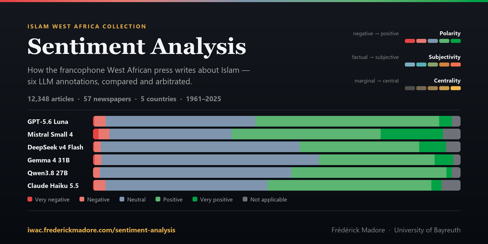

# IWAC Sentiment Analysis

[](https://github.com/fmadore/IWAC-sentiment-analysis/actions/workflows/deploy.yml)
[](https://doi.org/10.5281/zenodo.21806223)
[](LICENSE)
[](https://orcid.org/0000-0003-0959-2092)
[](https://huggingface.co/datasets/fmadore/islam-west-africa-collection)



A SvelteKit dashboard for exploring how large language models annotated the same corpus — 12,348 francophone West African press articles from 57 newspapers in Benin, Burkina Faso, Côte d'Ivoire, Niger and Togo, published 1961–2025 — on three dimensions: **polarity**, **subjectivity**, and the **centrality** of Islam and Muslims to the article. The current panel is six models; the archived one is three.

The corpus is the [_Islam West Africa Collection_](https://islam.zmo.de/s/afrique_ouest/page/accueil) (IWAC). The dashboard reports each model's distributions, their agreement, where they diverge, and blind third-party arbiter verdicts on the sharpest disagreements.

**Live site:** <https://iwac.frederickmadore.com/sentiment-analysis/>

**Sharing analyses:** [Citable URLs, supported state and citation limits](ma-visualisation-sentiments/docs/citable-urls.md). Article, comparison and arbiter CSVs append release, model, selection and URL provenance. Downloads capture the selection at click time and load only its required justification shards.

Two top-level areas: `ma-visualisation-sentiments/` (the SvelteKit app) and `data-preprocess/` (the Python that builds its JSON payloads).

---

## Two analysis generations

The corpus has been annotated twice, under two different prompts. **Both are published side by side.** Generation 2 is what the dashboard shows by default; generation 1 stays online, unchanged, so figures and URLs published from it keep resolving.

|                    | **v2 — current**                                                                                    | **v1 — archived**                                       |
| ------------------ | --------------------------------------------------------------------------------------------------- | ------------------------------------------------------- |
| Models             | GPT-5.6 Luna, Mistral Small 4 (2603), DeepSeek v4 Flash, Gemma 4 31B, Qwen3.8 27B, Claude Haiku 5.5 | GPT-5 mini, Gemini 3 Flash preview, Ministral 14B 2512  |
| Repo ids           | `luna`, `mistral-small`, `deepseek`, `gemma`, `qwen`, `haiku`                                       | `chatgpt`, `gemini`, `mistral`                          |
| Pairs              | 15                                                                                                  | 3                                                       |
| Articles annotated | 12,298 of 12,348 — except Qwen3.8 27B, at 12,098, and Claude Haiku 5.5, at 12,251                   | 12,279 of 12,348                                        |
| Subjectivity       | ordinal label upstream, mapped to rank 1–5; declined → `null`                                       | integer 1–5                                             |
| Arbiter            | Claude Opus 5, **whole panel** (one verdict per article); Claude Haiku 5.5 recused                  | Gemini 3 Pro, **pairwise** (one verdict per model pair) |
| Contract           | `src/lib/data/sentiment-v2.json`                                                                    | `src/lib/data/sentiment-v1.json`                        |

**The generation is derived from the id, never stored.** There is no `generation` URL parameter: `generationOf()` in `src/lib/domain/sentimentContract.ts` reads it off the dataset or pair id, which is why the two generations' ids must never collide (an import-time invariant asserts this). `?dataset=chatgpt` and `?pair=chatgpt-gemini` therefore keep working exactly as before and land you in the archive.

**Reaching the archive:** the model pickers offer only the current generation. A quiet footnote link in the methodology card switches to v1, after which a banner makes the state unmistakable with one click back.

### Reading a v1 ↔ v2 difference

The v2 prompt is not the v1 prompt. Subjectivity is answered as a label (`Très objectif` … `Très subjectif`) rather than an integer, the self-checklist instruction is gone, and boundary rules were added for Muslim actors in secular stories, Arab-state cooperation, and armed groups. **A difference between the two generations confounds the model change with the prompt change** — say so when reporting one. The app never mixes them: agreement statistics, prefetching and comparison pairs are all scoped to the active generation, because a six-rater kappa would measure the prompt rewrite as if it were disagreement between models.

Four further caveats specific to v2:

- The 50 articles that are neither French nor English are **skipped by design**. The prompt is French, and a French-prompted model returns confident but unusable output for them. They ship as all-null rows.
- **Qwen3.8 27B is 200 articles short of the rest of the panel**, and permanently so: it declined them across a full pass and three further rounds of retries, after which they were retired. The gap is **not missing at random** — it falls disproportionately on articles where Islam is peripheral (6.2% of the articles the panel calls `Marginal`, against 0.7–2.6% of every other centrality band). Anything computed on complete cases — Fleiss' κ, the consensus charts, the arbiter's selection frame — therefore leans towards material where Islam is central. Do not present the gap as repairable.
- **Claude Haiku 5.5 is 47 articles short of the other API members.** It joined the panel on 2026-10-22, without a pilot, and its corpus pass on 2026-10-23 logged 47 French articles as having no content in Omeka, although the rest of the panel had read them in August. Unlike Qwen's, this gap has a mechanical cause and may be repairable upstream; until it is, those 47 are complete cases for five models and not for six.
- **Every model declines subjectivity more often than the other two dimensions**, so any statistic involving it rests on a smaller sample than the polarity and centrality figures above. Declined over and above the rows the model skipped entirely: DeepSeek v4 Flash 489 (11,809 usable), Claude Haiku 5.5 406 (11,845), GPT-5.6 Luna 290 (12,008), Qwen3.8 27B 287 (11,811), Mistral Small 4 254 (12,044), Gemma 4 31B 243 (12,055).

> `chatgpt`/`gemini`/`mistral` are this repo's ids, not the dataset's column prefixes — the Hugging Face dataset renamed its sentiment columns from vendor slots to the model that actually produced each annotation. `iwac_preprocess.contract` holds the mapping and `sentiment_column()` is the only place a column name is assembled.

---

## What you can explore

Thirteen views, all sharing one filter rail (country → newspaper → polarity → subjectivity → centrality) except the three self-contained ones. Filter state round-trips through the URL, so any view is shareable.

| View             | What it answers                                                                           |
| ---------------- | ----------------------------------------------------------------------------------------- |
| **Charts**       | Polarity, subjectivity and centrality distributions — bars or pie, overall or per newspaper |
| **Trends**       | Cross-model historical shares with common or available cohorts; single-model counts/shares                                   |
| **Distribution** | Polarity × subjectivity cross-tabulation, with Spearman's ρ, p and n                      |
| **Volume**       | Newspaper-by-period collection timeline; publication volume per country                         |
| **Heatmap**      | Centrality by country and year, with sample counts and a minimum-count threshold                                                            |
| **Seasonality**  | Coverage across the twelve Hijri months — polar cycle or bars                             |
| **Newspapers**   | Newspapers ranked by mean rating or by share positive, negative or net, with 95% CIs      |
| **Map**          | Bubble map of geocoded places cited by the corpus, coloured by any dimension              |
| **Table**        | The article list, sortable, searchable by title and paginated; the detail carries the model's justifications and the whole panel's ratings |
| **Comparison**★  | Two models side by side, with per-dimension discrepancies and where they diverge          |
| **Agreement**★   | Panel reliability (Krippendorff's α, Fleiss' κ, leave-one-out, applicability), pair overview, full label patterns, confusion matrices and calibration |
| **Extremes**     | Keywords characterising the most extreme cases per category and model, by frequency or distinctiveness |
| **Arbiter**★     | Blind third-party verdicts on articles the models disagreed about most                    |

★ self-contained: full-width, own internal filters, no shared rail.

### Notes worth reading before interpreting

- **Seasonality exists because the Gregorian axis hides it.** The Hijri year drifts ~11 days a year, so lunar patterns are invisible in any year- or month-based view. Coverage nearly doubles during Ramadan and the hajj months. Stored Umm al-Qura dates are canonical; Gregorian-only records use a tabular (arithmetic) fallback. Neither establishes local lunar observance, as stated on the chart. Missing scores leave gaps; they never become zero.
- **The map counts mentions, not aboutness.** A bubble counts articles that _mention_ a place (`dcterms:spatial` is item-level tagging, ~3.8 places per article), never articles _about_ it. `Non applicable` is excluded from the mean but the article is still counted — it means "no stance expressed", so averaging it in would drag heavily-covered places toward the negative pole.
- **Agreement offers only corpus-scope facets** (country, newspaper). Sentiment filters are deliberately absent: selecting by the label under comparison would make the statistics circular. For v2 polarity, weighted κ and within-one-step agreement exclude `Non applicable`; the categorical matrix and unweighted agreement retain it, with their own denominators. The archived v1 calculation remains unchanged. A higher weighted κ alone does not establish a directional offset. The panel headline is ordinal Krippendorff's α, which keeps every article at least two models rated; Fleiss' κ is the complete-case secondary, counting only articles _every_ model rated, so on v2 it inherits Qwen's coverage gap. Whether the panel agrees that an article concerns Islam at all is a separate applicability statistic.
- **"Who breaks ranks" means something different at six models than at three.** The dissent profile names a model only when it stands alone against all the others; a 4–2 or 3–3 split has no lone dissenter and lands in "divided several ways". The ternary triangle is offered for the three-model archive only — a simplex over six models has no honest 2-D projection.
- **Newspaper ranking omits titles under 30 rated articles**, and states how many it omitted. Its confidence intervals describe within-sample variation in model ratings, not uncertainty from archival selection, missing articles or annotation error.
- **Historical model shares default to a common applicable cohort** for the chosen dimension. Available-case mode exposes each model’s own denominator. The pale band spans model minima and maxima; it is descriptive, not a confidence interval. Source-only country/newspaper filters apply, and a minimum count suppresses sparse points.
- **The newspaper timeline counts collected articles**, independent of model annotations. Empty cells indicate no articles in the selection, not that a newspaper published nothing. All titles are available through pagination and keyboard-operable filter buttons.
- **Full label patterns preserve the complete three- or six-model combination** and open the matching articles. The Sankey shows adjacent transitions only; merged ribbons do not retain full article paths.
- **Disagreements are not errors.** No model is ground truth, no human-coded reference sample exists yet, and disagreement often reflects a legitimate difference of reading. `Non applicable` and `Non abordé` are treated as non-comparable and exclude the row rather than counting as maximal disagreement; missing subjectivity skips only that dimension.
- **A missing rating is not `Non applicable`.** `Non applicable` is a verdict: the model read the article and found no stance. A null rating is one the model never produced — Qwen's declined rows, Claude Haiku 5.5's 47 skipped ones, the 50 articles no model annotates. The filter rail keeps them apart with a separate "Not annotated" chip on each dimension, so the table's counts under "Not applicable" match the charts, which skip nulls.
- **Arbiter percentages are conditional.** The arbiter reviews only articles selected _because_ the models disagreed sharply, so its verdicts measure who is right given a disagreement — never which model is better across the corpus. The v2 headline is how often each model gives the judge's own rating, per dimension; the overall-winner tally is secondary, because it follows the judge's tie-breaks.
- **Sentiment is not encoded by hue alone.** The polarity ramp is equal-lightness at the poles, so tooltip swatches also carry a shape.

### Example URLs

```
# Charts, filtered to one country
?view=charts&countries=Togo

# Trends in English, positive polarity only
?view=trends&lang=en&polarities=Positif

# Comparison mode on a generation-2 pair, wide discrepancies only
# (the v2 panel has fifteen pairs; `pair` takes any of them)
?view=comparison&compare=true&pair=deepseek-qwen&diffMin=2&diffMax=11

# Heatmap restricted to high centrality
?view=heatmap&centralities=Central&centralities=Très%20central

# The archived generation-1 analysis
?dataset=chatgpt
```

Core parameters: `view`, `lang`, `dataset`, `compare`, `pair`, `countries`, `journals`, `polarities`, `subjectivities`, `centralities`, `diffMin`, `diffMax`. Each view adds its own analytical and presentation state (comparison `dimensions`/`excludeNA`, agreement `scope`/`dimension`/`declined`, detail ids, sort and pagination, `chartState`); the full per-view list is in [Citable URLs](ma-visualisation-sentiments/docs/citable-urls.md). Every name the app reads or writes is declared in `src/lib/stores/url/constants.ts` (`URL_PARAMS`) or, for presentation options, as a key of `VIEW_OPTIONS`.

---

## Data

Everything ships as static JSON under `ma-visualisation-sentiments/static/data/`. The split is for load time, not tidiness.

| File                                        | Contents                                                                                      |
| ------------------------------------------- | --------------------------------------------------------------------------------------------- |
| `iwac_articles_base.json`                   | Shared article metadata, stored once for **both** generations (3.8 MiB, 598 KiB gzip)         |
| `iwac_sentiment_{model}.json`               | One model's scores keyed by article id (~58 KiB gzip)                                         |
| `iwac_justifications_{model}_{00..31}.json` | The ~90% prose portion, deterministically sharded by article id                               |
| `iwac_extreme_analysis_{model}.json`        | Keyword analysis of extreme cases, normalised (index + per-category id lists)                 |
| `iwac_arbiter_evaluations_{pair}.json`      | v1 pairwise arbiter verdicts (Gemini 3 Pro)                                                   |
| `iwac_arbiter_evaluations_v2.json`          | v2 panel arbiter verdicts (Claude Opus 5) — **see below**                                     |
| `iwac_places.json`                          | Geocoded `Lieux` authority records plus an article → place **edge list**                      |
| `world-110m.geojson`                        | Natural Earth 1:110m basemap (public domain), minified on purpose                             |
| `iwac_data_manifest.json` / `_v2.json`      | Per-generation contract version, immutable HF revision, byte sizes and SHA-256 for every file |

The frontend validates each JSON boundary at runtime, joins base metadata to the selected model's score map by article id, and exposes a retryable error state on failure. Only the selected model's scores load at startup; prose loads when an article detail opens (one shard) or a CSV is exported (all shards, in bounded batches); other models load when comparison mode activates or the panel arbiter view opens; the map, arbiter and extremes data load with their views.

Places ship as edges rather than pre-computed averages so the map answers to the same filter rail as every other view; aggregation happens in the browser.

### The generation-2 panel arbiter

`iwac_arbiter_evaluations_v2.json` is the published `--rule valence` run of `data-preprocess/arbiter-evaluation-v2.py`: every article where one model reads the coverage as positive and another as negative — 301 articles, re-judged on 2026-11-16 under arbiter prompt v2.3.0 in 301 paid calls for US$20.33 at effort `medium`. The file's `metadata.usage` is cumulative over every run that fed the durable cache: US$37.94 over 582 calls, including the original v2.2.0 run (281 calls, US$17.61). The arbiter reads the full article text and the five analyses under blind labels, rates each dimension itself, names the analysis it prefers per dimension and overall, and explains why. The arbiter view under v2 lists the articles with their verdicts; opening one shows the article itself (IIIF viewer where a manifest exists), why it was selected, and every model's rating against the arbiter's, with the models' own reasoning on demand. A build that omits the file shows an empty state. The v1 pairwise arbiter data is complete and unaffected.

Two things to keep in mind when reading the verdicts:

- **The frame is the panel's dissenter's frame.** Mistral Small 4 is the only model across the valence line in 189 of the 301 articles (162 as the sole negative reader); the strict four-against-one exact-label split is 56. The arbiter's polarity coincides with Mistral's in 40 articles, against 175–206 for each of the other four. Per-model tallies therefore measure how often the dissenter was upheld on the articles where it dissented, not the models' general quality.
- **Claude Haiku 5.5 is recused, because the judge is also Anthropic's.** Haiku joined the panel after the original run, and a judge reading a same-developer analysis is not a neutral judge: blind labels hide a model's name but not its house style, and LLM judges measurably favour their own output and that of related models (Panickssery et al., 2024; Wataoka et al., 2024; Goel et al., 2025). The contract's `arbiter.recusal` therefore keeps Haiku out of the arbiter's panel altogether — selection, prompt, blind labels and fingerprints run over the other five, the panel the original run judged and the v2.3.0 re-run kept. Haiku is compared with the verdicts afterwards: the verdict panel shows its rating beside the arbiter's, unlettered and marked *Recused*. On the 301 articles its polarity coincides with the arbiter's in 188, inside the 175–206 of the four members other than Mistral Small 4, so there is no sign of a reading the two Anthropic models share. What recusal cannot do is hear Haiku's own dissents: with six models the panel has 346 valence flips, and the 45 that exist only because of Haiku (38 as the sole negative reader, 7 as the sole positive one) are outside the frame. Settling those needs a judge from another developer — and since every frontier developer now has a model on the panel (OpenAI, Google, Anthropic, Mistral, DeepSeek, Alibaba), that judge must recuse its own developer's member in turn.
- **Recusal is derived from the judge's developer, never listed.** Every model in `sentiment-v2.json` names its `developer`, the arbiter names its own, and `arbiter.recusal.rule` is `same-developer`; `SentimentContract.recused_for()` / `recusedFor()` compute the recused set in both languages. An unregistered developer is an error rather than a judge that recuses nobody. The published fingerprints are unchanged (a test pins one).
- **A second judge is built but has not run.** `data-preprocess/arbiter-evaluation-v2-second-judge.py` runs a judge from another developer — Gemini 4 Argon by default, recusing Gemma — over the six-model valence-flip frame, with the same prompt, labels, presentation order and schema as the published run, and its own output file (`iwac_arbiter_evaluations_v2_<judge>.json`), durable cache and lock. `--frame recused` judges only Haiku's 45; `--frame full` judges all 346, so the 301 shared with the published run give a judge-agreement figure and a difference-in-differences estimate of each judge's affinity for its own developer's model. The panel arbiter view compares the two judges on their own ratings once that file is published; until then the section stays hidden.
- **Position bias was checked, with little power.** The five blocks are reshuffled per article, seeded on the article id. Over the 228 single-winner verdicts the winning analysis had been shown first, second, third, fourth and fifth 34, 50, 49, 44 and 51 times. Against a uniform 45.6 per slot that is χ² = 4.33 on 4 df (p = 0.36). Allowing for the realised seating — computed from each model's overall share of wins and where it sat on each article — the expected counts are 40.0, 51.7, 45.7, 45.2 and 45.5, and against those χ² = 1.89 (permutation p = 0.66, holding every article's seating and every model's number of wins fixed). Neither test rejects, but 228 verdicts could not detect a modest bias, and the first slot still won slightly fewer verdicts than its seating predicts (34 against 40). The v2.2.0 verdicts gave χ² = 8.94 (p = 0.06) naively and 3.83 (permutation p = 0.33) adjusted, also driven by the first slot. `data-preprocess/arbiter-position-check.py` recomputes these figures offline from the published file and the prompt's own `display_order`.
- **The published verdicts were re-judged under arbiter prompt v2.3.0; the original run used v2.2.0, which did not give the judge the annotators' codebook.** v2.2.0 carried a short scale reference and four demarcation rules of its own, and one of them contradicted the codebook: it filed a mention by proper name alone under `Marginal`, where the codebook says a religion guessable only from a name does not count (`Non abordé`). Prompt v2.3.0 reproduces the codebook's scales and rules verbatim (a shared fixture, `src/lib/data/arbiter-codebook-fixtures.json`, is checked against both prompts in pytest and vitest) and is the default for new runs. The methodology card shows the prompt recorded in the published file, and adds a caveat only for a v2.2.0 file. The v2.2.0 verdicts stay in the durable cache; `--prompt-version v2.2.0 --prune-cache-only` at their recorded revisions republishes them byte-for-byte.
- **What the codebook changed (v2.2.0 → v2.3.0, same 301 articles).** The judge kept its own rating on polarity in 256 articles (85%), on subjectivity in 266 (88%) and on centrality in 297 (99%). All but two polarity changes are one step: 13 `Négatif` → `Neutre`, 12 `Neutre` → `Positif`, 11 `Positif` → `Neutre`, 4 `Neutre` → `Négatif`, 2 `Très positif` → `Positif`, 1 `Positif` → `Très positif`, and 2 `Négatif` → `Positif`. `Négatif` verdicts fall from 32 to 21. The overall winner is the same model in 202 of 301. Polarity matches with the judge: GPT-5.6 Luna 191 → 175, Mistral Small 4 37 → 40, DeepSeek v4 Flash 190 → 190, Gemma 4 31B 205 → 206, Qwen3.8 27B 195 → 201, and the recused Claude Haiku 5.5 192 → 188. The panel's ratings and every row's spread are identical across the two runs; the re-run also read a newer revision of the article text (`5d67ae62` against `d5c318f5`), so a change cannot be attributed to the prompt alone where the OCR moved in between.

How the v2 arbiter differs from v1, and why:

- **Selection is the spread across the whole panel** (max minus min across every model, per dimension) rather than a pairwise gap. On the arbiter's five-model panel the contract's spread rule (any dimension ≥ 3) selects 2,102 articles, but 1,762 of those are triggered by _subjectivity_ alone — the dimension the models argue about most and where "who is right" is least well defined. Polarity triggers 103 and centrality 239. Widening the panel widened the frame: three models selected 1,449. A polarity spread of 3 already implies a sign reversal, so selecting on spread finds only the 103 widest reversals and structurally cannot reach the two-rank `Positif`/`Négatif` ones; the contract's second rule, `valenceFlip` (`--rule valence`), is what selects all 301. `--rule`, `--dimensions` and `--threshold` narrow the frame; they can only ever tighten it, because the validator recomputes eligibility from the contract.
- **The arbiter reads unmasked article text.** This fixes a real v1 flaw: the public Hugging Face projection masks `OCR` per row, so a large share of v1-arbitrated articles were judged on an empty string. v2 reads the private mirror (needs `HF_TOKEN`) and records **both** revisions — public scores and private text — in the metadata and the cache fingerprint. Only verdicts and justifications are published; no OCR is ever serialised.
- **Blind assignment is one global permutation** of the arbiter panel's model ids onto labels A–E, persisted and reused by every incremental run, so cached and new rows always mean the same thing. `parseArbiterV2EvaluationData` rejects any file whose permutation is not a bijection over the contract's models, which is also what keeps the label list and the panel the same size.

### Regenerating the data

Python 3.12+, from the repo root:

```bash
# Development and CI, including all runtime dependencies
pip install --require-hashes -r data-preprocess/requirements-dev.lock

# Runtime-only environment for generating data
pip install --require-hashes -r data-preprocess/requirements.lock
```

The `.lock` files pin every dependency and its hashes. The `.txt` files are the human-maintained version constraints; after changing them, regenerate both locks with the commands documented in `data-preprocess/requirements.txt`. The development lock is constrained to the runtime lock so generation and CI use the same runtime versions. CI audits that exact runtime set with `pip-audit -r data-preprocess/requirements.lock --disable-pip --require-hashes`.

Newly generated data manifests also record the runtime lock's filename and SHA-256 under `environment.requirements_lock`, identifying the dependency specification available to that generation. This optional field is absent when no lock is available; it does not verify the packages installed in the running interpreter. Existing published manifests are unchanged and make no claim to have been generated with the new lock.

Source reads resolve a single immutable Hugging Face commit per repository before loading. Set `IWAC_HF_REVISION` for the public dataset and `IWAC_HF_FULL_REVISION` for the private OCR mirror to reproduce a prior run; both the parquet and datasets fallback paths use the resolved commit.

Every export — scores and prose, extreme analysis, places, basemap and the panel arbiter — is staged and validated before publication, then promoted under one writer lock, so two exports can never interleave a mixed set. A recovery journal restores the previous complete set after an interrupted promotion. The lock, temporary export stages and retained panel-arbiter cache live in `ma-visualisation-sentiments/.data-staging/` (gitignored), never under `static/`, whose contents are published with the site. Run the same export command again to recover. Builds refuse a pending journal. Production builds bind the frontend to content-addressed `data/releases/<release>/` URLs; the service worker never substitutes files from a different release. The source `static/data/` layout and frozen v1 files remain unchanged.

**`--generation` is required and deliberately has no default.** An unflagged re-run would rewrite the frozen v1 files from whatever revision is current. A v2 run does not write `iwac_articles_base.json` at all — it fails loudly if an article in the base was deleted upstream.

**The base is the corpus, and it never grows by itself.** Every export is scoped to the base's article ids: articles ingested upstream since the panel ran are excluded and logged, because only part of the panel has read them — in October 2026 the collection gained 4,367 Burkina Faso articles that carry Claude Haiku 5.5's ratings and no other model's. A `--generation v1` run drops articles deleted upstream and admits new ones only with `--admit-new-articles`, which gives every model that has not annotated them null rows.

**Refresh with `refresh-all.py`.** It is the preferred path for any refresh: it stages every regenerated file — each requested generation's scores, prose shards and manifest, their extremes, and the places map — over a copy of the published set, runs the full `validate_generated_data.validate_all` on the result, and publishes once under the writer lock. Nothing is published unless the whole set validates, so the dashboard never sees the half-refreshed states the individual commands pass through (a v1 run alone leaves v2's coverage, v2's manifest checksum of the base and every extremes denominator stale until the rest have run). The safeguards are the individual commands' own code: v1 and the base are regenerated only with `--include-v1`, which is what an upstream deletion needs (the 2026-10-27 refresh that dropped article 78587 was v1, then v2, then extremes and places, by hand); new upstream articles are admitted only with `--include-v1 --admit-new-articles`; v2 still fails on an article deleted upstream when v1 is not included. One process resolves one Hugging Face revision, recorded in both manifests and in the optional `source` block now stamped on extremes and places payloads.

```bash
# v2 scores, prose, manifest and extremes, plus places; v1 and the base untouched
python data-preprocess/refresh-all.py --dry-run   # stage and validate only
python data-preprocess/refresh-all.py

# also v1 and the shared base (an upstream deletion), optionally admitting new articles
python data-preprocess/refresh-all.py --include-v1
python data-preprocess/refresh-all.py --include-v1 --admit-new-articles
```

The individual commands still work and publish only their own files:

```bash
# Scores, prose shards and the per-generation manifest
python data-preprocess/data-fetch.py --generation v2

# Keyword analysis of extreme cases
python data-preprocess/extreme-analysis.py --generation v2

# Map payload (generation-independent)
python data-preprocess/places-export.py

# Basemap — only when the Natural Earth source itself changes; pin the mirror
# commit with --ref <sha> (the default, `master`, moves)
python data-preprocess/basemap-export.py --ref <sha>
```

Arbiter runs cost money. Use a dry run first; a paid run requires confirmation or `--yes`. Always pass `--rule valence` for the v2 arbiter: the default rule is the contract's whole frame (spread **or** valence flip, about 2,270 articles), not the published 301.

```bash
# v2: re-judge the 301 (done on 2026-11-16 under v2.3.0; a resume reuses every cached verdict).
# 1. Counts and the cost estimate, no API call, nothing written
python data-preprocess/arbiter-evaluation-v2.py --rule valence --dry-run
# 2. Spend (needs ANTHROPIC_API_KEY and HF_TOKEN)
python data-preprocess/arbiter-evaluation-v2.py --rule valence --yes
# 3. If some articles were refused or returned invalid output, retry them once
python data-preprocess/arbiter-evaluation-v2.py --rule valence --retry-failed --yes

# Republish the original v2.2.0 verdicts from cache, without paid calls
# (pass the revisions they were judged at; the published file now records v2.3.0's)
python data-preprocess/arbiter-evaluation-v2.py --rule valence --prompt-version v2.2.0 --prune-cache-only \
  --source-revision 5629c24719d8b85bc3cb1d20edb4520647d0e37b --text-revision d5c318f5c0b1451e0c9a90809e359ab4ebec5910

# Publish a narrower v2 selection from cache: shrinking the public file is explicit
python data-preprocess/arbiter-evaluation-v2.py --rule valence --limit 20 --prune-cache-only --allow-shrink

# Move to the current Hugging Face revisions (see "Source revisions" below)
python data-preprocess/arbiter-evaluation-v2.py --rule valence --source-revision head --dry-run

# v2 second judge: frame counts and a cost estimate for both frames and every
# registered judge, no API call
python data-preprocess/arbiter-evaluation-v2-second-judge.py --dry-run

# ...then a pilot and the full frame (needs GOOGLE_API_KEY and HF_TOKEN)
python data-preprocess/arbiter-evaluation-v2-second-judge.py --frame full --limit 20 --yes
python data-preprocess/arbiter-evaluation-v2-second-judge.py --frame full --yes

# v1, pairwise: a frozen archive. Without --unfreeze it writes nothing and calls nothing.
python data-preprocess/arbiter-evaluation.py --unfreeze --prune-cache-only
```

**Re-judging under prompt v2.3.0.** The dry run prints the number of calls and the estimate, preceded by `301 published verdicts were judged under prompt v2.2.0; re-judging under v2.3.0 needs 301 call(s) (~$…)`. The estimate's output side is the measured `medium` figure from the v2.2.0 run, and its cached prefix is the v2.2.0 measurement, so it reads slightly low on the input side for the longer v2.3.0 instruction; the run's `metadata.usage` records the real cost. The prompt version is hashed into every fingerprint, so v2.2.0 and v2.3.0 verdicts never mix. **The public file is replaced only once the v2.3.0 selection holds at least as many verdicts as the published one** (or with `--allow-shrink`): until then every new verdict is checkpointed in the durable cache and `iwac_arbiter_evaluations_v2.json` keeps the 301 v2.2.0 verdicts intact. A run that ends short (refusals, invalid answers, an interruption) exits with status 1 and says so; rerun it — cached verdicts are not paid again — add `--retry-failed`, or accept a smaller file with `--allow-shrink`. The second judge uses the same prompt version as the primary by default.

**Source revisions.** The fingerprints also hash the Hugging Face revision of the scores and of the article text. A run that resumes a populated file reads the revisions recorded in its metadata (`source.scores.revision`, `source.text.revision`) and logs that it does; `IWAC_HF_REVISION` / `IWAC_HF_FULL_REVISION` or `--source-revision head|SHA` / `--text-revision head|SHA` move it deliberately (`--source-revision head` moves both repositories unless `--text-revision` is given). Reading upstream HEAD by default made every no-spend republish match nothing once HEAD moved on. A paid run refuses to fingerprint against an unknown revision.

**The shrink guard.** No arbiter script replaces a published file with fewer evaluations than it holds unless `--allow-shrink` is passed. The refusal says how many verdicts would be lost and why: outside the selection (rule, frame or `--limit`), another source revision, or another prompt version (with the `--prompt-version` that republishes them). The durable cache is still checkpointed.

**Failures are remembered.** A paid call that ends in a refusal, an invalid or a truncated response is recorded under its input fingerprint in the durable cache and is not billed again by a later run; `--retry-failed` re-attempts them. They are never published as verdicts, and the published `failed_evaluations` / `refused_evaluations` are derived from that record, so a run that makes no call keeps them. Transport errors are not remembered; `--max-consecutive-errors K` (default 5) stops the loop, after a checkpoint, when K calls in a row fail. A second breaker, `--max-consecutive-failures K` (default 5), stops it when K *billed* calls in a row come back truncated or invalid — an output ceiling too low for the effort, or a schema the judge keeps missing, would otherwise be paid for on every remaining article. Refusals neither count towards that streak nor reset it; a verdict resets it. Once the cause is fixed, `--retry-failed` re-attempts the remembered failures. The durable cache is checkpointed every ten billed calls, failures included, so a hard kill loses at most ten calls' failure memory and usage. Either breaker exits with status 1, and so does a run whose evaluated articles produced no verdict and at least one failure (truncated, invalid, API error); a run of refusals alone exits 0. A public export that fails mid-run is logged and the run continues; a failed final export exits non-zero with the verdicts durable. Runs that spend record the installed SDK version under `metadata.sdk_versions`.

The v2 arbiter bootstraps its durable cache from the existing published file and retains it at `ma-visualisation-sentiments/.data-staging/arbiter-v2/evaluations.json`. Each input fingerprint retains its verdict and source/model/prompt/effort provenance, including evaluations omitted by a later selection or belonging to an earlier source revision or prompt version. Expanding a narrowed selection again reuses matching paid work. `--prune-cache-only` makes no paid calls and never prunes this durable history. Recorded usage remains cumulative, rather than becoming the cost of the narrower selection. A republish that changes nothing does not rewrite the file, so its `generated` stamp stays; new stamps are UTC. A selection holding exactly the published verdicts keeps the public file's order (the order they were judged in); any other selection is ordered by the selection. So `--prompt-version v2.2.0 --prune-cache-only` at the recorded revisions leaves the published file byte-identical.

A populated cache must retain its original valid blind-label mapping and recorded effort. A missing/invalid mapping or a different `--effort` stops the run before either cache is rewritten; restore the mapping or resume at the recorded effort. Run a different-effort experiment in a separate checkout with its own output/cache instead of relabelling an existing run. `--limit` must be a positive integer and is checked before source loading. A text join that misses more than 1% of the selection (at least one article is tolerated) is an error rather than a warning. A dedicated lock covers the whole panel-arbiter session, and paid verdicts are checkpointed before the public export, so a failed publication can resume without repeating those calls. A dry run does not write the durable cache.

**The v1 arbiter is frozen.** `arbiter-evaluation.py` predates all of the above and is not refactored; it refuses any write or paid call without `--unfreeze`. Under `--unfreeze` an unreadable published file, or a populated one without a blind assignment, is an error rather than a fresh coin flip; it reads the source revision recorded in the published files (all selected pairs must agree, or pass `--source-revision`); and the shrink guard applies.

**Back up the `arbiter-v2/` directory before deleting ignored files or changing checkouts.** Git does not retain it, and the selected public file cannot recover paid evaluations that were never published or were omitted from the current selection. Restore the directory alongside the matching checkout to continue that history. Neither cache nor publication stores article OCR.

`data-preprocess/significant-differences-export.py` is a side helper rather than part of the pipeline: it writes ad-hoc CSVs of the sharpest pairwise disagreements into `exports/`, nothing the dashboard reads. It resolves its pairs through `shared.py`, so it still covers **generation 1 only**. Its Model A/B draw is seeded (`--seed`, 42 by default) for reproducibility, which makes the default assignment recomputable by anyone who reads the script: pass an undisclosed seed for a genuinely blind test.

Validate before committing generated data:

```bash
python -m pytest data-preprocess -q && python data-preprocess/validate_generated_data.py
```

An offline test suite, plus a validator that checks category domains, article-id coverage, prose shard placement, extremes membership (each category recomputed from the score files), arbiter eligibility, each verdict's stored spread under the rule its run recorded, fingerprints, and manifest hashes — entirely offline, for both generations, reporting every violation rather than the first. The test suite also pins the corpus figures quoted here (12,348 articles; null ratings per model and dimension) to the checked-in files, so a refresh that moves one fails until the prose follows. Both Python and TypeScript read the same checked-in contracts, and shared fixtures assert identical discrepancy (three-, five- and six-model panels), label-mapping and prose-shard behaviour across the two languages. `python -m mypy` type-checks the importable core (non-strict; configured in `pyproject.toml`).

Environment variables live in a root `.env` — copy [`.env.example`](.env.example): `ANTHROPIC_API_KEY` (v2 arbiter), `HF_TOKEN` (private mirror), `GOOGLE_API_KEY` (v2 second judge, Gemini 4 Argon; also the frozen v1 arbiter). Only the arbiter scripts load that file.

---

## Development

Node 24.15+ (24.x LTS) or 26+. `.nvmrc` and CI use Node 24 LTS. The Vitest 5
component suite uses jsdom 31, which requires this minimum patch level.

```bash
cd ma-visualisation-sentiments && npm install && npm run dev
```

| Script             | What it does                                                                |
| ------------------ | --------------------------------------------------------------------------- |
| `npm run dev`      | Dev server at `localhost:5173`                                              |
| `npm run build`    | Production build, then nesting, service-worker stamping and artifact checks |
| `npm run preview`  | Serve the final Pages artifact (including postbuild releases)               |
| `npm run check`    | `svelte-check --fail-on-warnings`, then `tsc -p tsconfig.node.json` — 0 errors, 0 warnings |
| `npm run lint`     | Prettier, ESLint, store-cycle detection, design-token validation, strict i18n key check |
| `npm run test:run` | Vitest 5 unit and integration tests                                         |
| `npm run test:e2e` | Playwright deep-link, failure-state and axe accessibility smoke tests       |

Run the checks in [`.claude/skills/verify/SKILL.md`](.claude/skills/verify/SKILL.md) before committing anything that ships through CI — the ordering and pass criteria are not guessable. CSS and component rules are in [DESIGN.md](DESIGN.md), and `npm run lint` enforces most of them.

Two repo-level helpers run against the root `.venv`:

- `python scripts/social-preview.py` regenerates `static/social-preview.png` from the shipped data. Re-run after a data refresh.
- `python scripts/oklch-to-hex.py` prints the sRGB renderings of the OKLCH design tokens, for the chart palette and `theme-color` meta tags.

### Architecture

- **`src/lib/components/`** — grouped by role: `common/`, `layout/`, `filters/`, `viz/` (ECharts charts and the MapLibre map), `ui/`, `data-display/`.
- **`src/lib/stores/`** — Svelte 5 runes accessor objects, one per domain (`filters`, `articles`, `datasets`, `comparison`, `arbiter`, `arbiterV2`, `extreme-analysis`, `ui`), plus `url/` for filter-state ↔ URL synchronisation. Leaf stores import from no other store; modules inside `stores/` must never import the barrel.
- **`src/lib/utils/`** — pure helpers, including the statistics modules: `agreement.ts` (Cohen's/Fleiss' κ), `krippendorff.ts` (Krippendorff's α), `correlation.ts` (Spearman's ρ), `newspaperRanking.ts`, `hijri.ts`, `placeAggregation.ts`.
- **`src/lib/domain/sentimentContract.ts`** — the dual-generation registry, with import-time invariants for id collisions, pair membership, shared scales and shard counts.
- **`data-preprocess/iwac_preprocess/`** — importable package split into the per-generation contract, revision-pinned source loading, discrepancy rules, recoverable generation publication, panel candidate selection and prompt construction, atomic serialisation, v1 cache reconciliation and the durable v2 cache lifecycle (`arbiter_lifecycle.py`). `shared.py` remains a compatibility facade for the command-line scripts.

Built with Svelte 5 (runes), SvelteKit 3 + `adapter-static`, TypeScript in strict mode, Tailwind CSS v4, ECharts 6, MapLibre GL v6, and Vite 8 (Rolldown). The design system is repository-owned: CSS tokens plus reusable Svelte controls, with automated token and class checks.

### Performance

HTML-referenced JavaScript is measured at build time against a **300 KiB gzip budget** — currently 136 KiB. The production browser tests additionally count actual transitive and dynamic imports: default charts, direct table and map links have budgets of **450, 180 and 600 KiB gzip**, respectively. Data transfer is reported separately, including all six background score prefetches. The tests verify chart/map isolation using the generated chunk manifest. These measurements are build-size budgets, not claims about latency on every device.

Views load their modules on demand and offer a localized reload action when a chunk fails. Data URLs include a content-derived release identifier; unchanged data keeps its cache across code-only deployments, while a changed dataset gets a new namespace. Offline requests never substitute another release's files. The build intentionally emits no `.gz`/`.br` siblings — GitHub Pages negotiates transfer compression. `npm run preview` serves the final static artifact so browser tests exercise the same release paths and stamped service worker that Pages receives.

---

## Deployment

Every push to `main` runs `.github/workflows/deploy.yml`. Frontend and Python jobs run in parallel: type checks, lint, unit tests, the measured production build, Playwright/axe, Python tests, Ruff, npm audit, pip-audit and pull-request dependency review all gate deployment. Actions are pinned to immutable commit SHAs, and only the deploy job receives Pages permissions.

The site is served from a **custom subdomain at a sub-path**, so the build output is nested: the adapter writes the app into `build/sentiment-analysis/`, and `scripts/nest-build.mjs` populates the build root with the three files GitHub Pages only reads from there (`CNAME`, a hoisted `404.html`, and a redirect `index.html`). This is necessary because a GitHub _project page_ supplies the `/repo-name/` prefix itself, whereas a _custom domain_ serves the artifact at the subdomain root.

`ma-visualisation-sentiments/deploy.config.js` is the single source of truth for the path and the domain — changing where the dashboard is served means editing that file and nothing else. `DEPLOY_PATH = ''` serves it at the subdomain root instead.

## Citation

Each release is archived on Zenodo. Machine-readable metadata lives in [`CITATION.cff`](CITATION.cff); GitHub's _Cite this repository_ button renders APA and BibTeX from it.

Cite the concept DOI — `10.5281/zenodo.21806223` — unless you need to pin a specific version; it always resolves to the most recent release.

> Madore, F. (2026). _IWAC Sentiment Analysis Visualization_ (Version 6.0.0) [Computer software]. University of Bayreuth. https://doi.org/10.5281/zenodo.21806223

```bibtex
@software{madore_iwac_sentiment_analysis,
  author    = {Madore, Frédérick},
  title     = {IWAC Sentiment Analysis Visualization},
  version   = {6.0.0},
  year      = {2026},
  publisher = {Zenodo},
  doi       = {10.5281/zenodo.21806223},
  url       = {https://github.com/fmadore/IWAC-sentiment-analysis},
  license   = {MIT}
}
```

Cite the underlying corpus separately — the _Islam West Africa Collection_ ([islam.zmo.de](https://islam.zmo.de/s/afrique_ouest/)) and its machine-readable export ([doi:10.57967/hf/9857](https://doi.org/10.57967/hf/9857)).

## Acknowledgements

Eight of the nine panel members across the two generations ran at a vendor's API. Qwen3.8 27B did not: it was self-hosted with vLLM on *festus*, the cluster of the Bayreuth Centre for High Performance Computing, which is why its column in the panel carries no invoice. The centre states that its funding acknowledgement is mandatory rather than a courtesy, so any publication reporting generation-2 results carries it verbatim:

> Calculations were performed using the festus-cluster of the Bayreuth Centre for High Performance Computing (https://www.bzhpc.uni-bayreuth.de), funded by the Deutsche Forschungsgemeinschaft (DFG, German Research Foundation) - 523317330.

The dashboard carries the same sentence in its footer, under Acknowledgements, whenever the current analysis is on screen. Wording checked against the [festus system guide](https://www.hpc.uni-bayreuth.de/clusters/festus/) on 15 September 2026; `CITATION.cff` has no field for a funding acknowledgement under CFF 1.2.0, so it is not recorded there.

## License

The application code is released under the [MIT License](LICENSE). The IWAC corpus it visualizes is distributed under CC BY-NC-SA 4.0 and is **not** covered by that licence — reuse of the data follows the collection's own terms.
